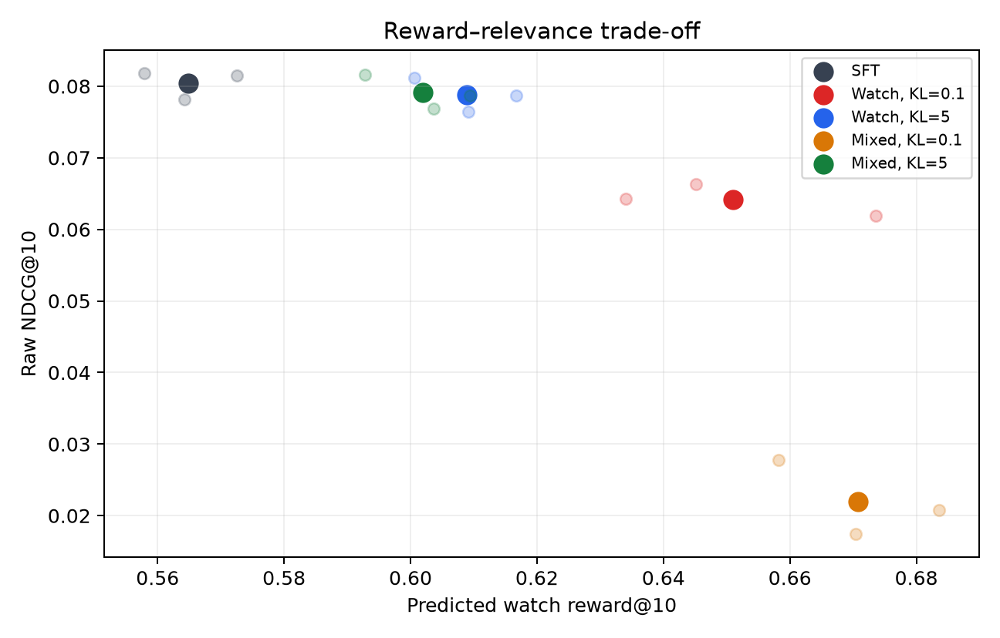
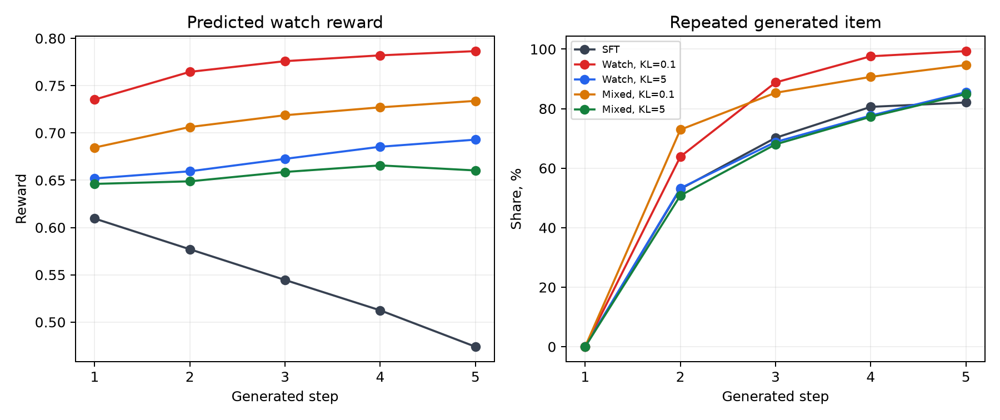

# RL-дообучение рекомендателя на KION

Компактный воспроизводимый эксперимент: GPT-2-подобный next-item рекомендатель → reward model → REINFORCE с KL-регуляризацией.

## Motivation and Research Question

Обычная next-item модель учится предсказывать следующее взаимодействие. Такая цель не тождественна удовлетворённости или долгосрочному интересу пользователя.

Исследуем вопрос:

> Можно ли повысить предсказанное вознаграждение с помощью RL, не разрушив релевантность и разнообразие рекомендаций?

Главный вывод: RL повысил оценку reward model, но не улучшил offline-релевантность. При слабом KL ухудшение NDCG сопровождалось концентрацией выдачи. Сильный KL ограничил оба эффекта.

## Experimental Setup

### Данные

Источник — [KION](https://github.com/irsafilo/KION_DATASET): 5.48 млн взаимодействий, 962 тыс. пользователей и 15.7 тыс. объектов. Все разбиения выполнены по времени.

| Часть | Целевые события | Горизонт метки возврата | Примеров |
|---|---|---|---:|
| SFT train | до 25 июля | не используется | 200 000 |
| RM train | до 18 июля | до 25 июля | 200 000 |
| Validation | 26 июля — 1 августа | до 8 августа | 3 000 |
| Test | 9–15 августа | до 22 августа | 3 000 |

Контекст состоит из последних 32 объектов строго предыдущих дней. Медиана `watched_pct`, словарь и популярность вычисляются только по train. Валидационные и тестовые метки возврата имеют полный семидневный горизонт.

Оценка проводится на тестовых событиях с объектами, известными по обучающему периоду; они покрывают 89.86% исходных подходящих test-событий. Cold-start объекты в метрики не входят.

Оценка выполняется по raw top-10 всего известного каталога. Истинный target не используется для фильтрации или построения выдачи.

### Модели

**SFT.** Causal Transformer в стиле GPT-2, обучаемый с нуля на item ID: 2 слоя, 4 attention heads, hidden size 64, dropout 0.1. Задача — next-item cross-entropy. Текстовые веса GPT-2 не используются.

**Reward model.** Отдельный causal Transformer получает историю и candidate item. Два выхода предсказывают долю просмотра и возврат пользователя через 1–7 дней.

**RL.** REINFORCE с batch-normalized advantage, точным KL к замороженной SFT-policy и supervised anchor 0.05. Reward model и reference policy заморожены. В каждом из трёх повторений проверен полный дизайн 2×2:

```text
watch = RM_watch
mixed = 0.65·RM_watch + 0.25·RM_return
        + 0.10·novelty − 0.20·repeat_in_history

reward ∈ {watch, mixed}, KL ∈ {0.1, 5}
```

Здесь `novelty = 1 − popularity` — популярностная новизна, вычисленная по train. Это не персонализированная новизна и не разнообразие списка: непопулярный объект может оставаться нерелевантным конкретному пользователю.

SFT и RM обучаются 2 эпохи; RL — 100 шагов. Все три этапа повторяются с seeds 42, 43 и 44. Внутри одного повторения RL-варианты используют общие SFT, RM и RL-seed.

## Reward Model Evaluation

Среднее ± SD по трём reward model на test:

| MAE доли просмотра | Pearson | AUC возврата |
|---:|---:|---:|
| 0.3460 ± 0.0041 | 0.3127 ± 0.0014 | 0.6754 ± 0.0035 |

Средний прогноз доли просмотра равен 0.5358, а наблюдаемое среднее — 0.4168. Следовательно, RM даёт полезный, но шумный и смещённый сигнал. Её качество измерено на залогированных взаимодействиях, а не на произвольных действиях RL-policy.

## RL Results

Все метрики оценены на одних и тех же 3 000 тестовых примерах. Для обучаемых моделей показано среднее ± SD по трём seeds. Coverage — доля каталога в raw top-10; top-1 share — максимальная доля одного объекта на первой позиции. `Predicted reward@10` — средний прогноз reward для десяти объектов с наибольшими логитами. Это характеристика детерминированной выдачи, а не математическое ожидание reward по всему распределению policy, которое оптимизирует REINFORCE.

| Модель | NDCG@10 | Recall@10 | MAP@10 | Pred. watch | Pred. mixed | Coverage, % | Max top-1, % | Repeat, % |
|---|---:|---:|---:|---:|---:|---:|---:|---:|
| SFT baseline | 0.0805 ± 0.0020 | 0.1413 ± 0.0006 | 0.0617 ± 0.0027 | 0.5649 ± 0.0074 | 0.5167 ± 0.0083 | 2.55 | 25.96 | 16.04 |
| Watch · KL 0.1 | 0.0642 ± 0.0022 | 0.1310 ± 0.0052 | 0.0436 ± 0.0013 | 0.6509 ± 0.0204 | 0.5767 ± 0.0192 | 0.97 | 67.79 | 14.16 |
| Watch · KL 5 | 0.0788 ± 0.0023 | 0.1403 ± 0.0017 | 0.0599 ± 0.0028 | 0.6088 ± 0.0080 | 0.5459 ± 0.0087 | 2.40 | 26.69 | 16.17 |
| Mixed · KL 0.1 | 0.0220 ± 0.0052 | 0.0422 ± 0.0071 | 0.0159 ± 0.0046 | **0.6708 ± 0.0127** | **0.6415 ± 0.0115** | 1.82 | 37.18 | 2.59 |
| Mixed · KL 5 | 0.0791 ± 0.0024 | 0.1407 ± 0.0020 | 0.0602 ± 0.0028 | 0.6019 ± 0.0085 | 0.5432 ± 0.0088 | 2.55 | 23.66 | 15.64 |



Во всех 12 парах «RL минус свой SFT» предсказанная доля просмотра выше, а NDCG@10 ниже. Для обеих Mixed-policy растёт и сама смешанная функция, которую они оптимизируют: +0.1248 при KL=0.1 и +0.0265 при KL=5 относительно их SFT. При слабом KL концентрация усиливается: максимальная доля одного top-1 достигает 67.79% для Watch и 37.18% для Mixed против 25.96% у SFT. При KL=5 значительного усиления концентрации не наблюдается, а NDCG остаётся близким к исходной модели.

Смешанная награда при KL=0.1 уменьшает повторы из истории и ослабляет top-1-концентрацию по сравнению с Watch, но сопровождается резким падением релевантности. Оптимизация отдельных beyond-accuracy компонент не гарантирует хорошего поведения всей выдачи.

### Декомпозиция reward и проверка другими RM

Средние составляющие `mixed` по трём seeds:

| Модель | 0.65·watch | 0.25·return | 0.10·novelty | −0.20·repeat | Итого |
|---|---:|---:|---:|---:|---:|
| SFT baseline | 0.3672 | 0.1661 | 0.0155 | −0.0321 | 0.5167 |
| Watch · KL 0.1 | 0.4231 | 0.1677 | 0.0142 | −0.0283 | 0.5767 |
| Watch · KL 5 | 0.3957 | 0.1670 | 0.0155 | −0.0323 | 0.5459 |
| Mixed · KL 0.1 | 0.4360 | 0.1781 | 0.0326 | −0.0052 | 0.6415 |
| Mixed · KL 5 | 0.3913 | 0.1672 | 0.0161 | −0.0313 | 0.5432 |

Прирост Mixed · KL 0.1 относительно SFT (+0.1248) складывается из watch (+0.0688), return (+0.0120), novelty (+0.0171) и почти полного снятия штрафа за повторы (+0.0269). Поэтому рост mixed reward не является ошибкой одной компоненты: при слабом KL policy одновременно выбирает более высоко оценённые RM, менее популярные и почти не встречавшиеся в истории объекты. Но формула не содержит next-item-релевантность, поэтому такой сдвиг совместим с резким падением NDCG.

Чтобы проверить, не является ли рост reward особенностью одной RM, каждая сохранённая выдача дополнительно оценена двумя RM из других seeds. Ниже показано среднее парное изменение относительно SFT при той же audit-RM по шести сочетаниям `policy seed × чужой RM seed`:

| Модель | Δ predicted watch | Δ predicted mixed |
|---|---:|---:|
| Watch · KL 0.1 | +0.0842 | +0.0585 |
| Watch · KL 5 | +0.0431 | +0.0286 |
| Mixed · KL 0.1 | +0.1016 | +0.1215 |
| Mixed · KL 5 | +0.0363 | +0.0260 |

Во всех 24 зависимых сочетаниях знак обоих контрастов положителен: рост прогнозируемого reward согласуется между разными инициализациями RM, а не наблюдается только на модели, использованной для RL. Эти значения не являются 24 независимыми экспериментами: у них общие тестовые контексты, обучающие данные и архитектура RM. Поэтому аудит не подтверждает рост реального отклика и не исключает общие смещения всех трёх RM.

## Behavioral Analysis and Multi-Step Generation

Для 500 фиксированных test-историй генерируются пять объектов. Каждый greedy-выбор добавляется в контекст перед следующим шагом.



К пятому шагу:

- SFT повторяет ранее сгенерированный item в 82.1% случаев;
- Watch · KL 0.1 — в 99.3%, Mixed · KL 0.1 — в 94.7%;
- при этом прогноз RM растёт на последующих шагах.

Рекомендация не равна взаимодействию. После первого шага синтетический контекст всё сильнее отличается от реальной истории. Поэтому rollout показывает неустойчивость генерации, а не реальную пятишаговую удовлетворённость.

## Discussion, Limitations and Conclusion

### Интерпретация

RL-дообучение повысило прогнозируемое вознаграждение, однако этот результат не означает увеличения реальной доли просмотра, удовлетворённости пользователей или retention. При слабой KL-регуляризации рост reward сопровождался снижением NDCG и концентрацией рекомендаций. Такое поведение совместимо с эксплуатацией несовершенной функции вознаграждения, но не является доказательством reward hacking.

В качестве прокси долгосрочной цели используется возвращение пользователя в сервис в течение семи дней. Эта метка отражает последующую активность пользователя, но не позволяет установить причинный вклад конкретного рекомендованного объекта. Поскольку в offline-данных отклик известен только для исторически наблюдавшихся взаимодействий, оценить влияние новой policy на retention без дополнительных предположений или онлайн-эксперимента невозможно.

### Ограничения

- Для обучения SFT и RM использованы выборки по 200 тыс. примеров из более крупных доступных наборов. Архитектура и гиперпараметры не проходили исчерпывающей оптимизации.
- RM имеет умеренную предсказательную способность (Pearson ≈ 0.31) и систематически завышает средний прогноз доли просмотра.
- Offline-данные KION не содержат контрфактических откликов пользователей на произвольные рекомендации новой policy.
- RL-дообучение использует одношаговую постановку. Многошаговая генерация выполняется без симулятора пользовательского отклика и не позволяет оценивать реальные долгосрочные эффекты.
- Эксперименты повторены с тремя случайными инициализациями, что позволяет оценить межзапусковой разброс, но недостаточно для надёжной оценки статистической неопределённости.

### Conclusion

Эксперимент показал, что RL-дообучение последовательного рекомендателя повышает прогнозируемое пользовательское вознаграждение, но создаёт компромисс между оптимизируемой функцией и релевантностью. При слабой KL-регуляризации policy существенно меняет распределение рекомендаций: Watch концентрирует выдачу на ограниченном наборе объектов, а Mixed частично снижает концентрацию и почти устраняет повторы из истории, но приводит к ещё более сильному падению NDCG.

Декомпозиция Mixed показала, что рост reward обеспечивается не одной компонентой, а совместным увеличением прогнозируемого отклика, предпочтением менее популярных объектов и уменьшением повторов. Популярностная новизна при этом не гарантирует персональной релевантности, что объясняет возможность одновременного роста Mixed reward и падения NDCG.

Сильная KL-регуляризация существенно ограничивает деградацию релевантности, сохраняя меньший прирост прогнозируемого reward. Cross-seed аудит показывает одинаковое направление эффекта для трёх независимо инициализированных RM, но не является независимой проверкой реального отклика, поскольку все RM используют одни данные и одну архитектуру.

При многошаговой генерации накапливаются повторы, а синтетический контекст всё дальше отходит от наблюдаемой пользовательской истории. Следовательно, такой rollout без модели пользовательского отклика нельзя интерпретировать как долгосрочную удовлетворённость.

Таким образом, RL способен оптимизировать заданный surrogate objective, но требует контроля отклонения от исходной policy, качества RM и изменений распределения рекомендаций. Влияние на реальную удовлетворённость и удержание пользователей может быть установлено только в online-эксперименте или в среде с корректно идентифицируемым контрфактическим откликом.

### Воспроизведение

Требуется Python 3.12.

```bash
python3.12 -m venv .venv
.venv/bin/pip install -r requirements-lock.txt
.venv/bin/python download_data.py
.venv/bin/python -u run_repeated.py
```

Устройство выбирается автоматически. Можно задать `--device cpu`, `--device mps` или `--device cuda`. Короткая проверка pipeline:

```bash
.venv/bin/python -u run_repeated.py --smoke
```

Полный эксперимент сохраняет веса и результаты в `artifacts/rerun_v1/`. При изменении исходного кода для повторного запуска необходимо использовать новый каталог артефактов.

Таблицы и графики можно восстановить из опубликованных JSON без переобучения:

```bash
.venv/bin/python scripts/summarize_results.py
```

Дополнительный аудит reward воспроизводится при наличии сохранённых весов и рекомендаций:

```bash
.venv/bin/python scripts/analyze_saved_policies.py --artifacts artifacts/rerun_v1
```

Ключевые файлы:

```text
run_repeated.py            полный эксперимент 2×2×3
src/kion_rl/data.py        temporal split и user histories
src/kion_rl/model.py       GPT2Rec и RewardModel
src/kion_rl/train.py       SFT, RM и REINFORCE
src/kion_rl/evaluate.py    raw metrics и rollout
scripts/summarize_results.py  таблицы и два графика
scripts/analyze_saved_policies.py  декомпозиция reward и cross-seed аудит RM
results/                   опубликованные результаты трёх seed
```
